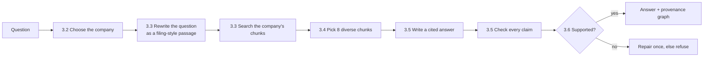
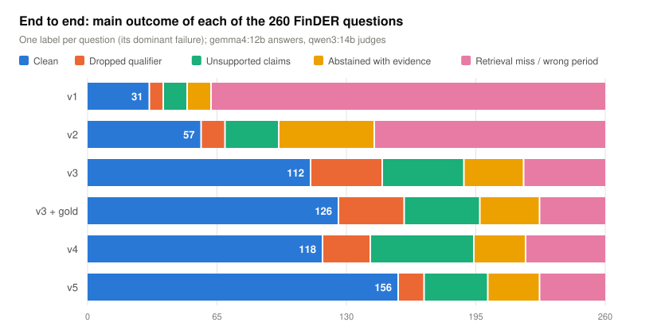

# sec-intel: cited answers from SEC filings, on a laptop

sec-intel answers questions about what public companies disclose in their SEC filings. Every
answer quotes the filing text it relies on. A second language model checks each sentence of
the answer against those quotes, and the system declines to answer when the filings do not
support one. Everything runs locally on one 16 GB laptop: no API keys, and no data leaves the
machine.

This README explains what the system does and why each part exists, follows one real question
through the whole pipeline, and then shows how well it works and how to run it. It assumes you
know Python and the basics of machine learning and have heard of retrieval-augmented
generation (RAG), but not that you know anything about SEC filings or this project.

> A research prototype, not investment advice. It reports what filings say; it does not
> predict wrongdoing.

Section numbers written as §N refer to the experiment log, [docs/EXPERIMENTS.md](docs/EXPERIMENTS.md).

**Further reading:** [results report with charts](docs/REPORT.md) ·
[experiment log](docs/EXPERIMENTS.md) · [open issues](https://github.com/Rahkovsky/sec_llm_project/issues)

---

## 1. The problem: answering questions from filings, with evidence

US public companies must file reports with the Securities and Exchange Commission (SEC), which
publishes them in a public database called **EDGAR**. Three kinds matter here:

| Form | What it is | Typical length |
|---|---|---|
| **10-K** | The annual report: business description, risk factors, legal proceedings, financial statements | 100–300 pages |
| **10-Q** | The quarterly report: a shorter, unaudited update | 40–100 pages |
| **8-K** | A report of a single event, such as an acquisition or an executive leaving | a few pages |

A 10-K is divided into numbered sections called **Items**, for example *Item 1A. Risk Factors* or
*Item 3. Legal Proceedings*. An analyst who asks "what does this company say about its
cyber-insurance?" needs the one or two paragraphs that answer it, out of thousands of pages
across several companies and years.

### Why a language model alone is not enough

The obvious first attempt is to ask a large language model (LLM) directly. That fails in two
ways. The model answers from whatever it remembers from training, which may be out of date or
about the wrong year, and it gives no way to check the answer: there is no citation to verify.

### Why plain retrieval-augmented generation is not enough either

The standard fix is **retrieval-augmented generation (RAG)**: search the filings for passages
related to the question, give those passages to the model, and ask it to answer only from them.
This helps, but in this domain it brings three problems of its own, and most of this project is
about solving them:

1. **The search finds the wrong passages.** Analyst questions are short and abbreviated, while
   filings are long and formal, so a naive search often returns cover pages and boilerplate
   instead of the paragraph that answers the question (section 3.3).
2. **The model drops the filing's hedges.** Filings are carefully worded: a company writes that
   insurance "*may not* be sufficient", or that it "*believes*" an outcome is unlikely. A model
   summarizing that text tends to state it as fact ("the insurance is not sufficient"), which
   changes the meaning. We call these hedge words **qualifiers**, and dropping one is a real
   error, not a style problem (section 3.5).
3. **The model answers when it should not.** If the passages do not contain the answer, the
   model still tends to produce one (section 3.6).

---

## 2. A running example

We will follow one real question from the evaluation set through every step. It is written in
the terse style of an analyst's note, which is what makes it hard:

> **Question:** "Impact on valuation & investor risk from Waters Corp's cyber ins. WAT."

(*WAT* is the stock ticker of Waters Corporation, a laboratory-instruments company.) The relevant
text is in Waters' 10-K filed in February 2025, in Item 1A, Risk Factors:

> "While the Company maintains cyber insurance, this insurance may not, however, be sufficient to
> cover the financial, legal, business or reputational losses that may result from an
> interruption or breach of its systems."

The system's actual answer was the following. It comes from the evaluation run of version `v5`,
the recommended configuration; versions v1 to v5 are the successive configurations whose results are
compared in section 4, each saved as a config file (section 5).

> The Company maintains cyber insurance, but this insurance may not be sufficient to cover the
> financial, legal, business, or reputational losses that may result from an interruption or
> breach of its systems [2]. The excerpts do not provide information regarding the specific
> impact of this insurance on the company's valuation or investor risk.

Notice three things, each produced by a different part of the system: the answer cites excerpt
`[2]`; it keeps the qualifier "may not … be sufficient"; and it says plainly that the filings do
not discuss the effect on valuation, instead of inventing one. The next section explains how
each step contributes.

---

## 3. How the system answers a question



### 3.1 Preparing the filings: chunks with metadata

A whole 10-K is far too long to give to a model, so each filing is split in advance into
**chunks** of about 1,800 characters (a few paragraphs). The splitter knows the 10-K structure:
it cuts at Item headings, so a chunk never mixes Risk Factors with Legal Proceedings. Each chunk
keeps **metadata**: ticker, company, form, filing date, fiscal year, and Item. The current index
holds about 730,000 chunks from 470 companies, filed 2022–2025.

In the example, the passage about cyber-insurance is one chunk, labelled *WAT, 10-K, filed
2025-02-25, Item 1A Risk Factors*.

### 3.2 Choosing the company

Searching all 470 companies for "cyber insurance" would return every company's cyber-insurance
paragraph, so the search must first be restricted to the company the question is about. An
**entity resolver** finds the company in the question text ("Waters Corp", "WAT") and turns it
into a **ticker filter**: only WAT chunks are searched. On 265 evaluation questions it
returns exactly the labelled companies 97% of the time. The four questions where it
picks a different main company turn out to be labelling errors in the benchmark: the question
text names another company than its label ([EXPERIMENTS.md](docs/EXPERIMENTS.md) §5.3).

### 3.3 Finding the relevant chunks

**The basic mechanism: embeddings.** An **embedding model** turns a piece of text into a vector
of numbers, such that texts with similar meaning get vectors pointing in similar directions. We
embed every chunk once, in advance. At question time we embed the question and return the chunks
whose vectors are closest to it (by cosine similarity). This is called **dense retrieval**. We
use the `Qwen3-Embedding-0.6B` model.

**First fix: the query instruction.** Qwen3-Embedding expects a short instruction in front of
each query that tells it what kind of search this is. The original instruction ("retrieve the
passages that answer it") made the search favour generic filing text: a third of the results
were cover pages and exhibits. Replacing it with one describing the actual situation ("a terse
search phrase from a financial analyst … 10-K annual report") raised the share of questions
whose answer passage is among the eight retrieved chunks (the **hit rate**, measured as Hit@8 in
section 4) from 36% to 53% (§1).

**Second fix: rewrite the question as a filing passage (HyDE).** Even with the right instruction,
"cyber ins." and "investor risk" look little like the formal sentence in the filing. The idea of
**HyDE** (Hypothetical Document Embeddings) is to bridge that gap by asking the language model to
write a short passage *in 10-K style* that would answer the question, and then search with that
passage as well as the question. Each chunk is scored by its average similarity to the question
and to the passage. The passage does not need to be true; it only needs to be worded the way a
filing is worded. For our example, the retrieval experiments recorded this passage:

> "The company may experience significant adverse effects on its financial condition and results
> of operations due to any unauthorized access to, or breach of, our internal systems, networks,
> or data. … Furthermore, any material cybersecurity breach may impair our ability to maintain
> operational integrity, affect our valuation, and present significant risks to our investors and
> stakeholders."

It uses the vocabulary of Waters' real risk factor ("breach", "systems", "financial",
"reputational") far more than the original question does, so its vector lands much closer to
that chunk.

Notice that the passage says "the company", not "Waters". The company name is **masked** before
the passage is written, and this turned out to matter. When the model knows it is writing about Waters, it writes from its memory of Waters, which pulls
the search toward what it remembers rather than what the filing says. On 361 natural-language
test questions, naming the company *lowered* the hit rate (0.83 → 0.75), while the company-blind
version raised it (0.83 → 0.97) (§7.1).

### 3.4 Picking eight different chunks (MMR)

A company repeats much of its 10-K from year to year, so the top results are often the same
paragraph from the 2023, 2024 and 2025 filings. Eight copies of one paragraph waste the space
given to the model. **Maximal marginal relevance (MMR)** picks the eight chunks one at a time,
each time choosing the chunk that is relevant to the question *and* least similar to the chunks
already picked. In the example, the eight chunks come from four filing years (2022 to 2025) and
from Risk Factors, Cybersecurity and Financial Statements, rather than one paragraph repeated.
Two of the eight are still cover-page chunks, which shows the remaining weakness of retrieval:
boilerplate still takes up some of the eight places.

MMR raised the hit rate from 53% to 59% on the development questions and held on the held-out
test questions; HyDE then raised it to 79% (§6, §7). The first six of the eight chunks are given
to the answer model as numbered excerpts `[1]`–`[6]`.

### 3.5 Writing the answer, then checking every claim

**Generation.** The answer model (`gemma4:12b`) is instructed to answer only from the excerpts,
to cite the excerpt behind each statement, to keep the filing's qualifiers, and to state which
part of the question the excerpts do not cover. That last instruction produces the second
paragraph of the example answer.

**Verification.** A model checking its own work tends to approve it, so a second model from a
different family (`qwen3:14b`, the **judge**) breaks the answer into individual factual claims
and labels each one *supported*, *partially supported*, *unsupported*, or *contradicted* by the
cited excerpt, quoting the text it relied on. A deterministic check
then confirms the quote really appears in that excerpt, so the judge cannot approve a claim with
an invented quote. In the example both factual claims are marked *supported*, with the quote
found in excerpt `[2]`, the 2025 Risk Factors chunk. Sentences that only describe what the
excerpts lack ("The excerpts do not provide …") are recognized as **meta-claims** and are not
scored as facts.

**Qualifier check.** For each supported claim whose quote contains a hedge word that the claim
lacks ("may" in the quote, none in the claim), the judge is asked whether the hedge was dropped.
If it was, the answer model gets one chance to restore it. In the example the claim kept "may
not", so nothing was flagged.

### 3.6 Answering or refusing

The answer is returned only if no claim is contradicted by its excerpt and its **groundedness**
(the share of claims supported, with partially supported claims counting half) is at least 0.6. If it fails, the model gets one repair attempt with the unsupported claims
pointed out; if that also fails, the system refuses ("I don't have enough grounded evidence …").
Every returned answer comes with a **provenance graph**: claim → quote → chunk → filing, saved as
`dag.json` and viewable as `dag.html`. This graph is also what lets the evaluation say, for each
wrong answer, whether retrieval or generation caused it.

---

## 4. How well it works

### How we measure

**FinDER** is a public benchmark of analyst-style questions about 10-Ks. For each question it
provides the **gold passage**: the filing text that answers it. We use 260 FinDER questions,
split into 128 for development and 132 held out for a single final test. We add 6 **placebo**
questions that cannot be answered (for example, a forecast from a 10-K that does not exist yet),
which the system must refuse.

Two measures matter most:

- **Hit@8** (retrieval): the share of questions for which at least one of the eight retrieved
  chunks contains the gold passage. If retrieval misses, the answer cannot be right.
- **Clean answer** (end to end): an answer whose claims are all supported by their excerpts and
  that keeps the filing's qualifiers. Each question's answer is given one label: clean, or the
  main thing that went wrong.

### Results

| | Start (v1) | Now (v5) |
|---|---|---|
| Hit@8 on the development questions | 0.36 | **0.79** |
| Questions answered (of 266) | 82 | **209** |
| Clean answers (of 260) | 31 | **156** |
| Share of claims the judge marks supported | 0.76 | **0.94** |
| Placebo questions refused | 6 of 6 | 6 of 6 |



The chart shows how the failure mix changed. In v1 most questions (pink) failed at retrieval:
the right passage was never found, so the model refused or answered from unrelated text. The
retrieval fixes of section 3.3–3.4 shrank that group from 198 to about 40 questions. As more
questions reached the answer step, its errors became the main problem: claims the excerpts do
not support (green) and dropped qualifiers (orange). The qualifier rule in v4 reduced the
dropped qualifiers that a person confirmed as real from 14 to 4, but made answers longer, and
longer answers carried more unsupported claims. A brevity rule in v5 (one sentence per point,
no background the question does not ask for) fixed that: claims per answer fell from 5.73 to
4.31, unsupported claims from 91 to 44, real dropped qualifiers to 2, and clean answers rose
from 118 to 156 ([report §3](docs/REPORT.md)).

Two things did *not* help and are switched off: re-scoring the chunks with a cross-encoder
**reranker**, and mixing keyword search (**BM25**) with dense retrieval. Both lowered Hit@8 on
these questions ([report §4](docs/REPORT.md)).

**How far to trust small differences.** The local models are not fully deterministic, even at
temperature 0: rerunning the same questions changes about 11% of the per-question labels. A
difference of a few questions between two end-to-end runs is therefore noise. Retrieval changes
were decided instead with paired experiments on the retrieval step alone, which is deterministic,
and with 95% bootstrap confidence intervals.

---

## 5. Running it

**Requirements:** Python 3.13, [Ollama](https://ollama.com), and about 16 GB of memory. The
answer model and the judge do not fit in memory together, so Ollama loads one at a time.

```bash
# install the package with the embedder, vector store and EDGAR client
uv pip install -e ".[dev,yaml,embeddings,vectorstore,sec]"
brew install ollama && brew services start ollama
ollama pull gemma4:12b && ollama pull qwen3:14b

# download filings (the SEC asks every client to identify itself) and build the index
export SEC_USER_NAME="Your Name" SEC_USER_EMAIL="you@example.com"
sec-intel --config config/local_16gb_v5.yaml fetch WAT AAPL --forms 10-K 10-Q
sec-intel --config config/local_16gb_v5.yaml index data/input/10-K data/input/10-Q

# ask
sec-intel --config config/local_16gb_v5.yaml ask "What does Waters say about its cyber insurance?"
```

**Without models:** `sec-intel-mock demo` runs the whole pipeline on a small synthetic corpus with
a deterministic stand-in model. It needs nothing installed beyond the package and is what CI runs;
its answers are not real.

More detail: [installation](docs/INSTALLATION.md), [real run](docs/REAL_RUN.md),
[mock run](docs/MOCK_RUN.md), [all commands](docs/COMMANDS.md). These guides still describe the
earlier model stack (gemma3 and Nomic embeddings); the configs in `config/local_16gb_v*.yaml`
are current.

### Configurations

Each evaluated version of the system is one config file, so any result can be reproduced:

| Config | Version |
|---|---|
| `config/local_16gb_v5.yaml` | **Recommended.** v4 plus the brevity rule in the answer prompt |
| `config/local_16gb_v4.yaml` | v3 plus the qualifier rule, qualifier check and repair, and a soft preference for the fiscal year a question names |
| `config/local_16gb_v3.yaml` | Query-instruction fix, MMR, company-blind HyDE, and the answer-stage fixes |
| `config/offline.yaml` | Mock model and hashing embeddings, for tests and CI |

### Running the evaluation

```bash
# answer, verify and build a provenance graph for each question (resumable)
python tools/provenance_dag.py --config config/local_16gb_v5.yaml \
    --cases eval/gold_plus_placebo.json -n 266 --out out/my_run --workers 8
# aggregate metrics and the per-question error labels
python tools/provenance_report.py --out out/my_run \
    --cases eval/gold_plus_placebo.json --config config/local_16gb_v5.yaml
```

A full run takes about 7.5 hours on an M1 Pro with `--workers 8` (several questions at once,
model calls grouped by model; about 9 hours without). The evaluation sets are in `eval/`:
`finder_semantic.json` (260 FinDER questions), `gold_plus_placebo.json` (those plus the 6
placebos), `synth_claude.json` (361 natural-language questions for retrieval checks), and hand
labels for dropped qualifiers and placebo answers. The retrieval experiments are in `tools/`
(`diversity_lab.py`, `rewrite_lab.py`, `rerank_lab.py`, `period_lab.py`).

---

## 6. Repository layout

```
src/sec_llm_project/sec_intel/
├── chunking/     splitting filings at Item headings, with metadata      (3.1)
├── retrieval/    entity resolver, dense search, HyDE, MMR, period filter (3.2–3.4)
├── generation/   prompts, cited answers, claim verifier, qualifier check (3.5–3.6)
├── provenance/   the claim → quote → chunk → filing graph               (3.6)
├── embeddings/   Hugging Face embedders (Qwen3, Nomic) and offline hashing
├── index/        Chroma vector store, index builder
├── llm/          Ollama client (with per-call timing) and the mock model
├── ingest/       rate-limited EDGAR download
├── monitor/      disclosure-change monitor: what changed between two years' filings
├── extraction/   structured extraction to schema-checked JSON
├── comparison/   filing-vs-filing comparison
├── evaluation/   metrics and benchmark runner
├── core/         configuration, shared types, audit log
├── app/cli.py    the sec-intel and sec-intel-mock commands
└── pipeline.py   wires all of the above from one config file
tools/            evaluation drivers, retrieval experiments, index updates, report charts
eval/             question sets and hand labels
docs/             results report, experiment log, guides
```

Besides question answering, the package includes a **disclosure-change monitor** (risk-factor
language added or removed between two years, new litigation, going-concern warnings, each with a
citation), **structured extraction** of filing sections into JSON, and a **filing comparison**.
These share the same retrieval and citation machinery but were not part of the evaluation above.

## 7. Development

```bash
pytest -q             # offline and deterministic; no models needed
ruff check src tests
```

CI (`.github/workflows/ci.yml`) runs the linter, the offline tests and the mock demo on Python
3.13 without any ML backends.

**Design constraints.** The system only reads filings and never trains on user input. Every
retrieval and answer is appended to `logs/audit.jsonl` with the prompt, model and citations. The
embedding model's version is stored with the index and checked when it loads, so an index is
never queried with a different embedder. EDGAR downloads stay under the SEC's limit of 10
requests per second and identify the client, as the SEC requires.

## License

MIT
