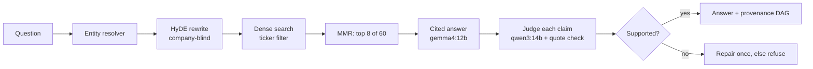

# sec-intel: cited answers from SEC filings, on a laptop

A local retrieval-augmented system that answers questions about public-company **10-K, 10-Q and
8-K filings** from SEC EDGAR. Every answer cites the filing text it relies on, a second model
checks every claim against that text, and the system refuses when the evidence does not
support an answer. Everything runs on one 16 GB machine through Ollama: no API keys, and no
data leaves the host.

> A research prototype, not investment advice. It retrieves and summarizes what filings say;
> it does not predict wrongdoing.

**Read next:** [Results report with charts](docs/REPORT.md) ·
[Experiment log](docs/EXPERIMENTS.md) · [Open issues](https://github.com/Rahkovsky/sec_llm_project/issues)

## Results

Measured on the 260 FinDER questions with gold passages plus 6 placebo questions that must be
refused, over four days of changes (details and confidence intervals in
[docs/REPORT.md](docs/REPORT.md)):

| | Start (v1) | Now (v4) |
|---|---|---|
| Gold passage retrieved in the top 8 (FinDER dev) | 0.36 | **0.79** |
| Questions answered (of 266) | 82 | **215** |
| Clean answers: supported, hedges kept (of 260) | 31 | **118** |
| Claims the judge marks supported | 0.763 | **0.879** |
| Placebo questions refused | 6/6 | 6/6 |


What moved the numbers: a better embedder query instruction, MMR diversity, and a
company-blind HyDE rewrite of the question for retrieval. For answers: tolerant quote matching,
partial answers instead of all-or-nothing refusal, and a rule plus judge check that keeps the
filing's hedges ("may", "believes"). Cross-encoder rerankers and BM25 hybrid search were tested
and made retrieval worse.

## How it works



| Part | Implementation |
|---|---|
| Generator | `gemma4:12b` (Ollama), temperature 0 |
| Judge | `qwen3:14b` (Ollama): a different model family from the generator, plus a deterministic check that each quote is really in the cited chunk |
| Embedder | `Qwen/Qwen3-Embedding-0.6B` with an analyst-style query instruction |
| Index | Chroma over SEC-aware chunks (split on `Item N.` headings; ticker, form, fiscal year and section kept as metadata); ~730k chunks, 470 companies, filings 2022–2025 |
| Retrieval | Ticker-filtered dense search, company-blind HyDE (the question plus a generated 10-K-style passage, averaged), MMR (λ 0.85) over the top 60 → top 8 |
| Answer checks | Claim-level verification, dropped-qualifier check and repair, abstention gate, one repair attempt |
| Provenance | Each answer becomes a claim → quote → chunk → filing graph (`dag.json`, `dag.html`), and every question gets one error label |
| Audit | Every retrieval and answer is appended to `logs/audit.jsonl` with prompt, model and citation metadata |

Other features: a **disclosure-change monitor** (risk-factor language added/removed between two
years, new litigation, going-concern signals, all cited), **structured extraction** to
schema-checked JSON, and a **filing-vs-filing comparison**.

## Quick start

```bash
# 1. install
uv pip install -e ".[dev,yaml]"          # core + tests
./setup_local.sh                           # local model stack (see docs/INSTALLATION.md)
ollama pull gemma4:12b && ollama pull qwen3:14b

# 2. download filings and build the index (SEC asks for a contact identity)
export SEC_USER_NAME="Your Name" SEC_USER_EMAIL="you@example.com"
sec-intel --config config/local_16gb_v4.yaml fetch AAPL MSFT --forms 10-K 10-Q
sec-intel --config config/local_16gb_v4.yaml index data/input/10-K data/input/10-Q

# 3. ask
sec-intel --config config/local_16gb_v4.yaml ask "How does Apple describe supply-chain concentration risk?"
```

No models? `sec-intel-mock demo` runs the whole pipeline offline with a deterministic mock model
and a synthetic corpus (this is what CI runs). Full guides: [installation](docs/INSTALLATION.md),
[real run](docs/REAL_RUN.md), [mock run](docs/MOCK_RUN.md), [every command](docs/COMMANDS.md).
Some of these guides still name the earlier stack (gemma3 + Nomic); the configs in
`config/local_16gb_v*.yaml` are current.

## Evaluating

```bash
# end-to-end: answer, verify and build a provenance DAG per question (resumable)
python tools/provenance_dag.py --config config/local_16gb_v4.yaml \
    --cases eval/gold_plus_placebo.json -n 266 --out out/my_run
python tools/provenance_report.py --out out/my_run \
    --cases eval/gold_plus_placebo.json --config config/local_16gb_v4.yaml
```

| Eval set | Size | Use |
|---|---|---|
| `eval/finder_semantic.json` | 260 FinDER questions with gold passages | retrieval and end-to-end; dev/test split in `eval/finder_split.json` |
| `eval/gold_plus_placebo.json` | 260 + 6 placebos | end-to-end runs |
| `eval/synth_claude.json` | 361 natural questions | retrieval diagnosis |
| `eval/qualifier_labels*.json`, `eval/placebo_labels.json` | hand labels | dropped qualifiers, placebo refusals |

Retrieval changes are decided with paired labs (`tools/diversity_lab.py`, `rewrite_lab.py`,
`rerank_lab.py`, `period_lab.py`) that report Δ with 95% bootstrap CIs, because end-to-end
runs vary by ~11% of per-question labels between identical runs.

## Configs

| Config | What it is |
|---|---|
| `config/local_16gb_v4.yaml` | **Current default**: v3 + qualifier rule, judge check and repair, soft period filter |
| `config/local_16gb_v5.yaml` | v4 + brevity rule (candidate; better on 56 questions, full run pending) |
| `config/local_16gb_v3.yaml` | MMR + company-blind HyDE + answer-stage fixes |
| `config/local_16gb.yaml` | Base 16 GB profile |
| `config/offline.yaml` | Mock model + hashing embeddings, for tests and CI |

## Repository layout

```
src/sec_llm_project/sec_intel/
├── core/         config, shared types, audit log
├── llm/          Ollama provider (per-call timing log, model-grouping scheduler) and mock
├── embeddings/   Hugging Face embedders (Qwen3, Nomic) and offline hashing, versioned
├── chunking/     SEC-aware section splitting
├── index/        Chroma store, builder, incremental finalize
├── retrieval/    dense + BM25 + fusion, MMR, HyDE rewrite, period filter, entity resolver
├── generation/   grounded answers, claim verifier, qualifier check, prompts
├── provenance/   claim-provenance DAG
├── monitor/      disclosure-change monitor
├── extraction/   schema-constrained extraction
├── comparison/   filing-vs-filing diff
├── ingest/       rate-limited EDGAR download
├── evaluation/   metrics and benchmark runner
├── app/cli.py    sec-intel / sec-intel-mock
└── pipeline.py   facade wiring everything from one config
tools/            eval drivers, labs, index updates, report figures
eval/             question sets and hand labels
docs/             report, experiment log, guides
```

## Development

```bash
pytest -q             # offline and deterministic
ruff check src tests
```

CI (`.github/workflows/ci.yml`) runs lint, the offline tests and the mock demo on Python 3.13
with no ML backends installed.

## Design constraints

| Property | How |
|---|---|
| Local only | Ollama + local embedder; no API calls, no data leaves the host |
| No training on user data | The system retrieves and reasons over filings; nothing is fine-tuned on inputs |
| Cited evidence only | Answers cite the excerpts they use; quotes are checked verbatim against the cited chunk |
| Refuse when unsure | Evidence-score, groundedness and confidence thresholds; placebo questions test it |
| Auditable | JSONL audit log, deterministic prompts, embedding version checked when an index loads |
| Official sources | EDGAR with fair-access rate limiting (≤ 10 requests/s) and a contact User-Agent |

## License

MIT
