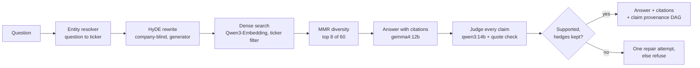
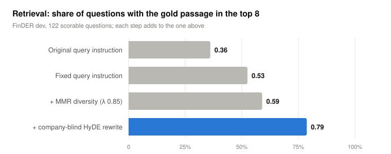
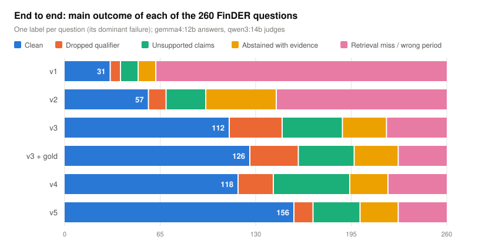
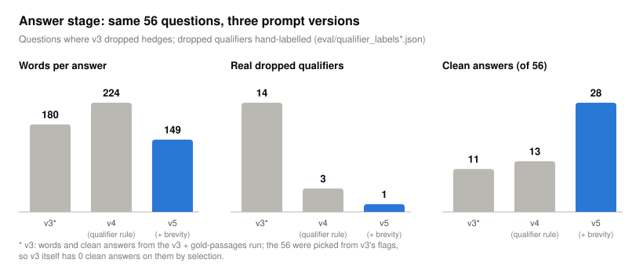
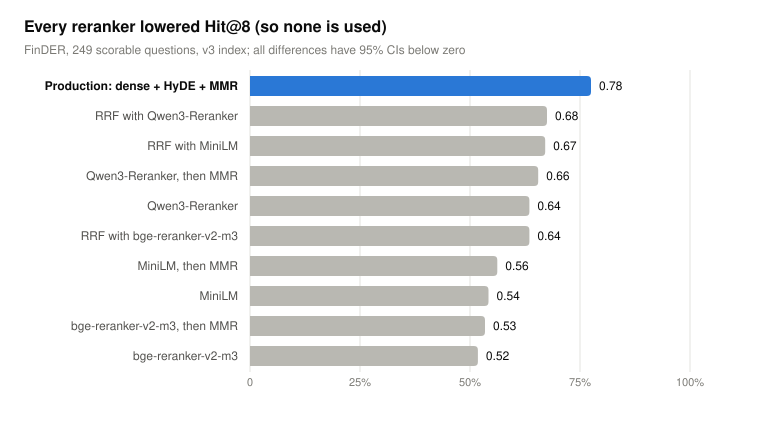

# Results report: making a local SEC-filings RAG system answer correctly

*November 10–14, 2026. Summary of [EXPERIMENTS.md](EXPERIMENTS.md), which has every table, method and
caveat; section numbers below (§) point there. Open work is tracked in issues
[#1–#8](https://github.com/Rahkovsky/sec_llm_project/issues).*

## Summary

The system answers questions about 10-K, 10-Q and 8-K filings with cited excerpts, an
independent judge that checks every claim, and a refusal when the evidence is weak. It runs
fully on one 16 GB laptop (generator `gemma4:12b`, judge `qwen3:14b`, embedder
`Qwen3-Embedding-0.6B`). Over five days of measured changes on the 260 FinDER gold questions:

| | Start (v1) | Now (v5) |
|---|---|---|
| Gold passage retrieved in the top 8 (FinDER dev) | 0.36 | **0.79** |
| Questions answered (of 266) | 82 | **209** |
| Clean answers: supported, hedges kept (of 260) | 31 | **156** |
| Claims the judge marks supported | 0.763 | **0.940** |
| Context recall (gold passage covered by the retrieved chunks) | 0.300 | **0.692** |
| Placebo questions refused (false premise never asserted) | 6/6 | 6/6 |

Three changes did most of the work: a better query instruction for the embedder, MMR
diversity in the top 8, and a company-blind HyDE rewrite of the question. After that the
errors were mostly in the answer step. Two prompt rules fixed most of them: keep the filing's
hedges (v4), and answer briefly, one sentence per point (v5). v5 is the recommended
configuration.

## How the system works



Each answer is stored with a claim-provenance graph (claim → quote → retrieved chunk → filing),
so every error can be traced to retrieval or to generation. That trace is how each question in
the charts below gets one label. The `sec-intel ask` command resolves the company from the
question (97% exact on FinDER, §5.3); the evaluation runs below give retrieval the case's own
ticker, and an entity-resolved run is open work (issue #6).

**Evaluation sets** (§0): 260 FinDER questions with gold passages (dev 128 / test 132, tuned on
dev and confirmed once on test), 6 placebo questions that must be refused, and 361 natural
questions written by Claude for retrieval diagnosis. Retrieval comparisons are paired, with
95% bootstrap confidence intervals.

## 1. Retrieval: from 0.36 to 0.79



| Step | Hit@8 (dev) | What changed | § |
|---|---|---|---|
| Original query instruction | 0.361 | Qwen's query prefix pulled boilerplate (cover pages, exhibits) into the top 8: 34.5% of results vs 19% of the corpus | §1 |
| Fixed query instruction | 0.525 | A "terse search phrase from a financial analyst" prefix; queries embedded in fp32 | §1 |
| + MMR diversity (λ 0.85) | 0.590 | Re-ranks the top 60 so the top 8 are not near-copies of one section; held on test (+0.079, CI above 0, 11 wins / 1 loss) | §6 |
| + company-blind HyDE | 0.787 | The generator writes a short 10-K-style passage that would answer the question, with the company name masked; its embedding is averaged with the question's | §7 |

Two findings worth knowing:

- **Naming the company in the HyDE prompt hurts natural questions.** On the 361 natural questions,
  HyDE with the company named *lowered* Hit@8 (0.825 → 0.753). The model writes from memory
  of that company instead of in generic filing language. Masking the name fixed it
  (0.825 → 0.972, 53 wins / 0 losses), and FinDER kept its gain (§7.1).
- **The embedder was not the problem.** Qwen3-Embedding looked worse than Nomic after the
  switch. The cause was the query instruction; with the fixed instruction, Qwen beats Nomic
  0.522 vs 0.413 on the same questions (§1).

## 2. End to end: where each question ends up



| Outcome (of 260 FinDER questions) | v1 | v2 | v3 | v3 + gold | v4 | v5 |
|---|---|---|---|---|---|---|
| Clean | 31 | 57 | 112 | 126 | 118 | **156** |
| Dropped qualifier ("may" stated as fact) | 7 | 12 | 36 | 33 | 24 | 13 |
| Unsupported claims | 12 | 27 | 41 | 38 | 52 | 32 |
| Abstained although the evidence was retrieved | 12 | 48 | 30 | 30 | 26 | 26 |
| Retrieval miss or wrong period | 198 | 116 | 41 | 33 | 40 | 33 |

- **v1 → v2:** the query-instruction fix (§3).
- **v2 → v3:** MMR + HyDE, a cleaned corpus (10-K/A amendments and Exhibit-13 wrappers replaced
  by the real annual reports, §5.2), plus answer-stage fixes: punctuation-insensitive quote matching
  (57 correct quotes had been rejected for curly quotes or dashes), partial answers instead of
  all-or-nothing refusal, and citation re-pointing (§8–§9). Retrieval misses fell from 116 to 41.
- **v3 + gold:** the same system with every FinDER gold passage added to the index. It gains
  only 14 clean answers, so missing documents are a small part of the remaining error; ranking
  is the larger one (§10, issue #8).
- **v3 → v4:** a prompt rule to keep the filing's hedges, a judge check for dropped qualifiers,
  and one repair attempt (§11, §14). Hand-labelled real dropped qualifiers fell from 14 to 4,
  but answers got 17% longer and unsupported claims rose (issue #1).
- **v4 → v5:** a brevity rule in the answer prompt (§15, §17). Claims per answer fell from 5.73
  to 4.31 and unsupported claims from 91 to 44; real dropped qualifiers 4 → 2. Paired with v4,
  69 questions became clean and 31 stopped being clean (sign test z = 3.8, well beyond the
  run-to-run noise).

As retrieval improved, more questions reached the answer step and its errors became visible.
Unsupported claims and abstentions despite retrieved evidence are now the largest failure
classes after retrieval misses.

## 3. Answer stage: keeping hedges without longer answers



On the 56 questions where v3 dropped hedges (§15):

| Same 56 questions | v3* | v4 (qualifier rule) | v5 (+ brevity rule) |
|---|---|---|---|
| Words per answer | 180 | 224 | **149** |
| Real dropped qualifiers (hand-labelled) | 14 | 3 | **1** |
| Clean answers | 11 | 13 | **28** |
| Unsupported claims, share of all claims | 20.0% | 16.6% | 23.3% |

\* Words and clean answers from the v3 + gold run; the 56 were picked from v3's flags, so v3
itself has 0 clean on them by selection.

The brevity rule ("one sentence per point, each point once, no background the question does
not ask for") cancels the length cost of the qualifier rule. Clean answers more than double,
well above the ~6-question run-to-run noise on 56. On these 56 the unsupported share rose,
because shortening removed supported detail while the unsupported claims stayed.

The full 266-question run confirmed the rule and reversed that worry (§17):

| All 260 FinDER questions | v3 | v4 | v5 |
|---|---|---|---|
| Words per answer | 144 | 171 | **126** |
| Claims per answer | 4.88 | 5.73 | **4.31** |
| Claim support (meta claims excluded) | 0.927 | 0.925 | **0.951** |
| Unsupported claims | 76 | 91 | **44** |
| Real dropped qualifiers (hand-labelled) | 14 | 4 | **2** |
| Clean answers | 112 | 118 | **156** |

The 56 had been chosen for long, hedge-heavy answers; across all questions the shorter answers
carry fewer unsupported claims, not more.

## 4. What did not work



| Tried | Result | § |
|---|---|---|
| Cross-encoder rerankers (MiniLM, bge-reranker-v2-m3, Qwen3-Reranker; alone, then MMR, or fused) | Every variant lowers Hit@8, by 0.10 to 0.26. A likely reason: they score the terse question against the chunk, without the HyDE passage that makes dense retrieval work. Untried: rerank against the HyDE passage (issue #5) | §13 |
| BM25 + dense hybrid | Lowers Hit@8 on FinDER's terse questions at every weight (−0.07 to −0.12); turned off, which also saves ~5 GB of RAM | §2 |
| Paraphrasing the question | No change (0.590 → 0.590 dev, −0.06 test) | §7 |
| Near-duplicate removal; clustering the top 200 | +0.008; −0.090. Year-to-year versions of a section are chunked differently, so duplicates are same-topic rather than same-text, which MMR handles | §6 |
| Period filter for year-named questions | Raises the share of retrieved chunks from the right fiscal year from 0.69 to 0.95, but Hit@8 change is not significant (+0.009); kept in soft mode, needs more year-named questions (issue #7) | §12 |

## 5. How much to trust the numbers

- **Run-to-run noise.** Ollama at temperature 0 with a fixed seed is still not deterministic:
  with identical retrieved evidence, about half of the answers differ in wording and ~11% of
  per-question labels change (§10, issue #4). End-to-end differences of a few questions are
  noise. Retrieval changes were therefore decided on paired, deterministic retrieval labs, with
  confidence intervals.
- **The judge is a model.** Claim support is measured by `qwen3:14b` plus a deterministic quote
  check. Dropped qualifiers were hand-labelled (`eval/qualifier_labels*.json`) because the
  lexical proxy has precision 0.19 and the judge check has recall 0.43 (§11, issue #3).
- **Placebos.** All six were refused in substance in every run. The built-in counter
  undercounts refusals written in prose; `tools/placebo_check.py` asks the judge whether the
  false premise is asserted instead (18/18 agreement with hand labels, 8/8 written positive
  controls caught, §16, issue #2).
- **One dataset.** FinDER questions are terse analyst phrases; the natural-question set guards
  against tuning to that style, but it was written by an LLM.

## 6. Run time

A full 266-question evaluation took about 10 hours. On a 16-question timing run (§16), a
question takes ~122 s serially: three LLM calls (HyDE rewrite, answer, claim judge) and ~13 s
of retrieval and checks. Model swapping, the first suspect, is only 7% of the time (a load takes
~4.5 s). Most of the time goes to prompt processing (~120 tokens/s on this laptop) and to the
judge's own output (~520 tokens per question at ~12 tokens/s; the judge is 63% of LLM time).
`--workers N` runs several questions at once and groups calls by model; with 8 workers the
16 questions took 15% less time (1954 s → 1663 s), with judge support unchanged within noise.
The remaining levers are faster prompt processing and a shorter judge output.

## Open work

| Issue | Topic |
|---|---|
| [#1](https://github.com/Rahkovsky/sec_llm_project/issues/1) | Answer length after the qualifier rule: solved by the brevity rule (v5, §17) |
| [#2](https://github.com/Rahkovsky/sec_llm_project/issues/2) | Automatic placebo metric: done (`tools/placebo_check.py`, §16) |
| [#3](https://github.com/Rahkovsky/sec_llm_project/issues/3) | Dropped-qualifier judge check: a held-out label set |
| [#4](https://github.com/Rahkovsky/sec_llm_project/issues/4) | Nondeterminism at temperature 0 |
| [#5](https://github.com/Rahkovsky/sec_llm_project/issues/5) | Rerank with the HyDE passage in the query |
| [#6](https://github.com/Rahkovsky/sec_llm_project/issues/6) | Finish embedding the remaining 10-Ks; entity-resolved run |
| [#7](https://github.com/Rahkovsky/sec_llm_project/issues/7) | Period filter on more year-named questions |
| [#8](https://github.com/Rahkovsky/sec_llm_project/issues/8) | Gold passages lift coverage only modestly; ranking is the gap |

## Reproducing

```bash
# end-to-end run (resumable) and its report
python tools/provenance_dag.py --config config/local_16gb_v5.yaml \
    --cases eval/gold_plus_placebo.json -n 266 --out out/provenance_16gb_v5
#   add --workers 8 to group model calls by model (~15% faster, §16)
python tools/provenance_report.py --out out/provenance_16gb_v5 \
    --cases eval/gold_plus_placebo.json --config config/local_16gb_v5.yaml
python tools/placebo_check.py out/provenance_16gb_v5   # is a false premise asserted?

# retrieval labs (paired, with bootstrap CIs)
python tools/diversity_lab.py ...   # §6
python tools/rewrite_lab.py ...     # §7
python tools/rerank_lab.py ...      # §13

# the charts in this report
python tools/make_report_figures.py
```

Run outputs (`out/`) and the index (`data/`) are not in the repository; the tools named in each
EXPERIMENTS.md section regenerate them.
